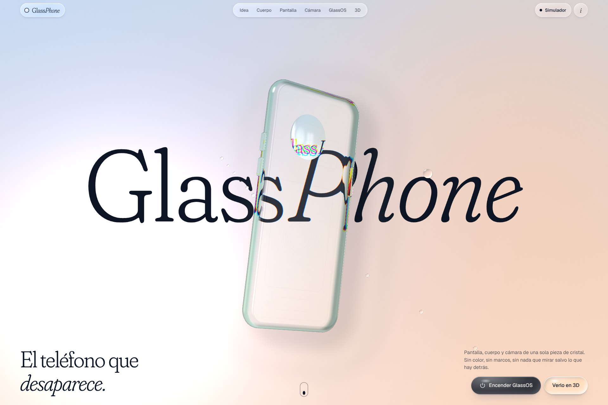

# GlassPhone

Un teléfono que no existe: transparente del todo, de una sola pieza de cristal. La web lo presenta bajando por un día entero (del alba a la noche), deja girarlo en 3D y permite encender GlassOS, su sistema operativo, y usarlo de principio a fin en el navegador. El teléfono, el sistema, las cifras y los materiales son inventados.

**Ver: [samilososami.com/claude/glassphone](https://www.samilososami.com/claude/glassphone/)**



## Qué hay dentro

- **El cristal refracta de verdad.** El fondo (el cielo, las palabras gigantes) es una función escrita en el sombreador, y el teléfono vuelve a evaluar esa misma función desplazada según la normal de cada punto. Lo que se ve a través del cristal es lo que hay detrás, con dispersión cromática en los cantos. La lente de la cámara es una gota y, como una gota, invierte la imagen.
- **El teléfono baja contigo.** Un único canvas fijo; el scroll mueve y gira el modelo entre capítulos (canto, parte trasera, pantalla, lente, sistema) y cambia la hora del día.
- **Gotas de agua.** Mover el ratón o tocar la pantalla condensa gotas que resbalan, se funden y refractan el fondo. Los botones son gotas con dos muelles: se aplastan al pulsar y tiemblan al soltar.
- **Visor 3D.** Arrastrar para girar, pellizcar o rueda para acercar, dos dedos para mover. Se puede encender la pantalla, ver el interior y cambiar la luz.
- **GlassOS.** Arranque propio, pantalla de bloqueo, inicio, centro de control y doce apps: Teléfono, Mensajes, Cámara, Fotos, Calendario, Reloj, Tiempo, Notas, Calculadora, Contactos, Música y Ajustes. Con *Transparencia real* usa la cámara trasera del dispositivo como fondo, y el teléfono de quien mira pasa a ser de cristal.

## Cómo se hizo

| | |
|---|---|
| Hecho con | Claude, en Claude Code |
| Fecha | 11 de noviembre de 2026 |
| Tiempo | Unas 2 h 30 min, del prompt a la web publicada |
| Motor | Three.js r128 como base y sombreadores GLSL escritos a mano; el resto es HTML, CSS y JavaScript sin dependencias |
| Recursos | Ninguno: ni imágenes ni modelos. Geometría, texturas de pantalla, circuitos e iconos se dibujan con código al cargar |

## Archivos

```
glassphone/
├── index.html      Estructura y textos de la página
├── css/site.css    La página: cristal líquido, gotas, capítulos
├── css/os.css      GlassOS
├── js/scene.js     WebGL: mundo, palabras, gotas y teléfono
├── js/main.js      Scroll, botones, visor y arranque del simulador
├── js/os.js        Núcleo de GlassOS (arranque, bloqueo, inicio, control)
├── js/apps.js      Las doce apps
└── js/ui.js        Iconos y utilidades
```

## Hasta dónde llega

Es un concepto visual, no un producto. Las apps funcionan (la calculadora calcula, los mensajes contestan, la cámara guarda fotos, las notas se editan), pero nada se guarda al salir y los datos son de mentira. La transparencia real necesita permiso de cámara y una página servida por HTTPS. En equipos sin WebGL la página se lee igual, sin el modelo.

## El prompt

> crea una página web espectacular que muestre un teléfono llamado Glass Phone, ¿vale? Todo junto. Entonces, es un teléfono completamente transparente, ¿vale? Pantalla transparente, carcasa transparente, cámara transparente, todo transparente. Y el sistema operativo también crea Glass OS, ¿vale? Que es básicamente un sistema operativo full transparente en el que predomina el Glass Morphism y el Liquid Glass estilo iOS, ¿vale? Entonces, que se vea espectacular y también, o sea, entonces la página web debe mostrar este teléfono, debe mostrar un render 3D con el que podrás mover el teléfono y tal y cosas de estas, y tiene que sentirse como una experiencia completamente visual, ¿vale? Debes adaptar el diseño de la página web y el estilo al teléfono, concretamente, ¿vale? A cómo se siente, debes como adaptar la interfaz a lo que sería Glass OS y cosas por el estilo. Y debe sentirse increíble, ¿vale? No debe verse como AI Slop ni nada por el estilo, sino que tiene que ser muy fluido todo, muy estético. La página web debe estar orientada tanto como para verse en teléfono como para verse en ordenador, pero principalmente teléfono, ¿vale? Entonces tiene que ser espectacular, ya un poco lo que tú veas, pero mi idea sería, por ejemplo, un diseño estilo Liquid Glass y super animaciones super fluidas, botones grandes, físicas, podríamos decir, estilo gotas de agua sobre cristal, cosas así, ¿vale? Y eso, como explica las características del teléfono, cuál es como la idea principal, que es como crear un teléfono minimalista al máximo, precioso, no sé qué, lo que tú veas, ¿vale? Entonces, como conforme bajas la web debe ir, por ejemplo, que aparezca un render del teléfono, y conforme vas bajando la web debe ir viéndose como el teléfono baja contigo, se va moviendo en función de si muestras el sistema operativo, de si muestras la parte de atrás, la carcasa, lo que sea. Y al final debe aparecer dos cosas. Primero, poder visualizar el modelo 3D del teléfono, ¿vale? Rollo que directamente puedas interactuar, hazlo con WebGL, por ejemplo, y que veas como el teléfono en 3D, puedas moverlo, agrandarlo, girarlo, rotarlo, que esté súper bien hecho, ¿vale? Y la segunda es que puedas, como un simulador del Glass OS, ¿vale? Como que un botón de entrar en simulación o algo por el estilo, y que aparezca como desde la boot animation, algo que ponga como completamente desde cero, ¿vale? Como si la página web mostrase en full screen, ¿vale? El sistema operativo desde cero, ¿vale? Con una boot animation de Glass OS customizada, que se vea como la pantalla de bloqueo, crea aplicaciones, crea interfaz, aplicación de configuración, pon típicas aplicaciones que podrían ser cámara, calendario, contactos, WhatsApp, lo que sea, pero todo orientado a la UI, ¿vale? A la interfaz de Glass OS. Debe verse espectacular. Cuando lo tengas, hosteas la página web con App Deploy en un subdominio temporal y me la pasas.
