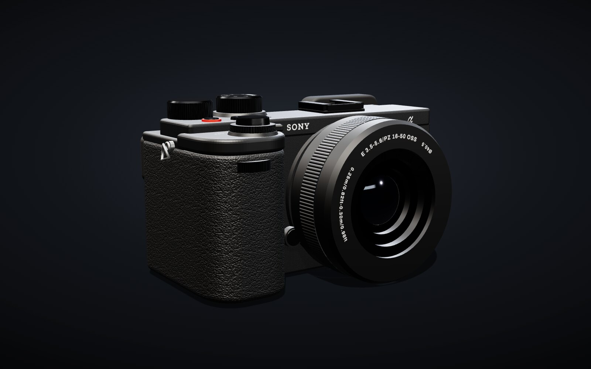

# Sony α6700 en 3D

Modelo 3D interactivo de la Sony α6700: se puede girar, acercar, mover y quitarle el objetivo para ver la montura y el sensor. No es un escaneo ni un archivo CAD; la geometría está escrita a mano en `camera.js` y se genera al abrir la página. Página no oficial, sin relación con Sony.

**Ver: [samilososami.com/claude/sonya6700-3d](https://www.samilososami.com/claude/sonya6700-3d/)**

## Cómo se hizo

| | |
|---|---|
| Modelo | Claude Fable 5.2, en Claude Code |
| Fecha | 11 de noviembre de 2026 |
| Tiempo | 17 min, del prompt a la web publicada |
| Tokens | ~70.000 de salida · ~6,6 M procesados contando lecturas de caché (cifras aproximadas, medidas justo antes de publicar) |
| Motor | Three.js 0.170, materiales físicos, entorno de estudio y sombras en tiempo real |
| Medidas | Las oficiales (122 × 69 × 75,1 mm) y la posición de cada mando medida sobre las fotos |

## Trazado de rayos

El botón **✦ Ray tracing** activa un path tracing progresivo en la GPU ([three-gpu-pathtracer](https://github.com/gkjohnson/three-gpu-pathtracer)): luz rebotada, sombras suaves y reflejos reales sobre una peana negra. La imagen se afina mientras la cámara está quieta. No usa RTX; funciona con WebGL 2, pero la primera activación compila sombreadores y puede tardar desde unos segundos hasta más de un minuto en gráficas integradas. Se añadió en una segunda petición, igual que las texturas finas, y no está contado en el tiempo ni en los tokens de arriba.

## Hasta dónde llega

Las proporciones y la colocación de los mandos siguen las fotos de referencia, pero es una reconstrucción a ojo, no una copia exacta. La empuñadura real tiene curvas más complejas y faltan detalles finos (tapas inferiores, interior de la zapata, textura exacta de la polipiel). El prompt pedía analizar decenas de imágenes; solo existen 15 con licencia libre, que son las que se usaron.

## El prompt

> crea otro proyecto dentro de samilososami.com/claude. lo añades al repo tambien.
> debes crear un render hiperrealista en 3d, de la sony a6700. basicamente, ponte a analizar decenas de imagenes de la sony, y de ahi, creas un render HIPERREALISTA. con todo lujo de detalles. debe ser exactamente fiel al diseño de la sony a6700. la pagina web debe permitir hacer zoom, girarlo, rotarlo, etc etc. y añades toda la info al final del modelo, cuanto has tardado, el prompt, las imagenes de referencia que has usado, etc

## Imágenes de referencia

Todas de Wikimedia Commons. En `refs/` hay una miniatura de cada una.

| Archivo | Original | Autor | Licencia |
|---|---|---|---|
| `ref-01.jpg` | [Sony A6700 by Henry Söderlund.jpg](https://commons.wikimedia.org/wiki/File:Sony_A6700_by_Henry_S%C3%B6derlund.jpg) | Henry Söderlund | CC BY 2.0 |
| `ref-02.jpg` | [Sony Alpha 6700 (DSC 7816).jpg](https://commons.wikimedia.org/wiki/File:Sony_Alpha_6700_(DSC_7816).jpg) | Tsungam | CC BY-SA 4.0 |
| `ref-03.jpg` | [Sony Alpha 6700 (DSC 7818).jpg](https://commons.wikimedia.org/wiki/File:Sony_Alpha_6700_(DSC_7818).jpg) | Tsungam | CC BY-SA 4.0 |
| `ref-04.jpg` | [Sony Alpha 6700 (DSC 7819).jpg](https://commons.wikimedia.org/wiki/File:Sony_Alpha_6700_(DSC_7819).jpg) | Tsungam | CC BY-SA 4.0 |
| `ref-05.jpg` | [Sony Alpha 6700 (DSC 7820).jpg](https://commons.wikimedia.org/wiki/File:Sony_Alpha_6700_(DSC_7820).jpg) | Tsungam | CC BY-SA 4.0 |
| `ref-06.jpg` | [Sony Alpha 6700 (DSC 7821).jpg](https://commons.wikimedia.org/wiki/File:Sony_Alpha_6700_(DSC_7821).jpg) | Tsungam | CC BY-SA 4.0 |
| `ref-07.jpg` | [Sony Alpha 6700 (DSC 7823).jpg](https://commons.wikimedia.org/wiki/File:Sony_Alpha_6700_(DSC_7823).jpg) | Tsungam | CC BY-SA 4.0 |
| `ref-08.jpg` | [Sony Alpha 6700 (DSC 7824).jpg](https://commons.wikimedia.org/wiki/File:Sony_Alpha_6700_(DSC_7824).jpg) | Tsungam | CC BY-SA 4.0 |
| `ref-09.jpg` | [Sony ILCE-6700 19 aug 2023a.jpg](https://commons.wikimedia.org/wiki/File:Sony_ILCE-6700_19_aug_2023a.jpg) | 昼落ち | CC BY-SA 4.0 |
| `ref-10.jpg` | [Sony ILCE-6700 19 aug 2023b.jpg](https://commons.wikimedia.org/wiki/File:Sony_ILCE-6700_19_aug_2023b.jpg) | 昼落ち | CC BY-SA 4.0 |
| `ref-11.jpg` | [Sony ILCE-6700 19 aug 2023c.jpg](https://commons.wikimedia.org/wiki/File:Sony_ILCE-6700_19_aug_2023c.jpg) | 昼落ち | CC BY-SA 4.0 |
| `ref-12.jpg` | [Sony ILCE-6700 19 aug 2023d.jpg](https://commons.wikimedia.org/wiki/File:Sony_ILCE-6700_19_aug_2023d.jpg) | 昼落ち | CC BY-SA 4.0 |
| `ref-13.jpg` | [Sony ILCE-6700 19 aug 2023e.jpg](https://commons.wikimedia.org/wiki/File:Sony_ILCE-6700_19_aug_2023e.jpg) | 昼落ち | CC BY-SA 4.0 |
| `ref-14.jpg` | [Sony ILCE-6700 19 aug 2023f.jpg](https://commons.wikimedia.org/wiki/File:Sony_ILCE-6700_19_aug_2023f.jpg) | 昼落ち | CC BY-SA 4.0 |
| `ref-15.jpg` | [Sony α6700 at Cultural & Creative Blvd. 20260403 131417.jpg](https://commons.wikimedia.org/wiki/File:Sony_%CE%B16700_at_Cultural_%26_Creative_Blvd._20260403_131417.jpg) | Solomon203 | CC BY-SA 4.0 |
